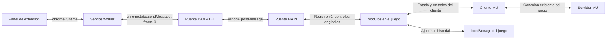

## Compatibilidad del 22/10/2026

El puente añade index-D-gOSya0 / layout-DCITLqBq tras auditar n/V/aw y store.world. Helper usa los aliases de propiedades/tooltip nF/nH de ese build. Se conservan pares anteriores y degradación de desconocidos. [Evidencia](client-oct22.md).

# Cómo trabajar la extensión de MU y preparar variantes por personaje

Compatibilidad Chrome revisada el 21/10/2026: page-bridge reconoce index-Do3IjarP.js / layout-CoOAKkh-.js y conserva index-URnTVW_1.js / layout-DQbdTT-G.js. Reutiliza los exports auditados n/V/aw del módulo del cliente y publica getters de compatibilidad para estado, mundo (estado.world), social y eventos. Los clientes con globals conservan su ruta original; builds desconocidos o interfaces incompletas quedan sin conectar y presentan un diagnóstico. No importa boot ni crea escenas, sockets, motores o intervalos. El adaptador pertenece a la extensión; los userscripts standalone no lo incluyen. Las pruebas son aisladas, sin cuenta real.

Para crear una extensión independiente en otra carpeta, usar la [guía autocontenida para proyectos nuevos](standalone-extension-AGENTS.md), copiada como `AGENTS.md` en el proyecto de destino. Este documento explica la extensión existente; sus contratos y módulos no son requisitos de un proyecto nuevo.

Guía para personas y agentes. Revisión del código local: 18/10/2026. Describe la implementación observada; la sección de variantes es una propuesta y no una capacidad ya implementada. Para versiones e instalables vigentes consultar los manifiestos, no las versiones históricas de esta guía ni de otros documentos.

## 1. Modelo general

El proyecto mantiene seis userscripts autónomos y los empaqueta también como una extensión Chrome Manifest V3. El generador copia sus bytes: no hay un segundo Helper para Chrome. Tampermonkey y la extensión son dos formas de ejecutar las mismas fuentes.

Los motores viven en el documento del juego. La pestaña externa es una interfaz que consulta sus vistas y reenvía acciones. El service worker comunica pestañas y abre el panel; no ejecuta el leveleo. No se necesita un servidor local en la instalación final.

El panel no abre otro socket al servidor ni replica credenciales. Los módulos usan las interfaces del cliente ya cargado; la aceptación de una acción depende del cliente y del servidor.

## 2. Dónde trabajar

| Fuente | Responsabilidad |
| --- | --- |
| `src/helper/level-helper.user.js` | Cycle de leveleo/reset, Home, rutas, party, loot, buffs, Caza y adaptadores visuales/estadísticas. |
| `src/radar/golden-radar.user.js` | Observación de entidades/eventos, minimapa, historial y contador de invasión. |
| `src/config/config.user.js` | Ventana común y transacciones de configuración de los proveedores. |
| `src/analytics/analytics.user.js` | Mediciones de experiencia y su historial, con motor propio. |
| `src/interface/interface.user.js` | Adaptación visual de los controles nativos. |
| `src/hub/hub.user.js` | Montaje de hosts y acciones originales; sin motor ni polling propio. |
| `src/extension/` | Panel externo, renderer, worker y dos puentes. |
| `scripts/extension-package.cjs` | Genera el manifiesto MV3, define módulos/assets y verifica el paquete. |
| `scripts/release.cjs`, `scripts/rollback.cjs` | Publicación local y recuperación de conjuntos. |
| `demos/`, `tests/`, `tests/fixtures/` | Simulaciones y validación aislada. |
| `dist/`, `releases/` | Instalables generados y archivos históricos; no editar a mano. |

Antes de modificar módulos leer [README](../README.md), [organización y releases](organization-and-updates.md) y [contratos y diseño](addon-design.md). El repositorio puede contener cambios de otros trabajos: revisar `git status` y coordinar los archivos compartidos antes de editar/publicar.

## 3. Cómo se carga en el navegador

La fuente del manifiesto es el generador, no un `manifest.json` editable en `src`.

1. Chrome carga `page-bridge.js` en `MAIN`, en `document_start`. Instala el registro y la adaptación de presentación antes de los módulos.
2. En `document_idle` carga en `MAIN`, en este orden: Radar, Helper, Config, Analytics, Interface y HUB.
3. En `document_idle` carga `content-bridge.js` en `ISOLATED`, con acceso a mensajería de extensión.
4. El icono ejecuta `worker.js` para abrir/enfocar `panel.html`. El usuario selecciona la pestaña de MU y conecta el panel.

El manifiesto limita el alcance a `https://mu.mormon.garden/*`, documento principal (`all_frames:false`), con Chrome mínimo 120. Declara `action`, `background.service_worker` y permiso de host para ese origen. No solicita permisos `tabs`, `scripting`, `storage`, `downloads` ni acceso a todos los sitios. Usa APIs de pestañas con ese alcance limitado y consulta sus propios contextos para localizar el panel.

La CSP del panel limita scripts al paquete y declara `connect-src 'none'`. Los módulos MAIN comparten contexto con la página y dependen de su cliente/CSP. No modificar permisos o ampliar orígenes para resolver un fallo sin identificar antes su causa.

No ejecutar a la vez Tampermonkey y la extensión. Las marcas `Symbol.for('mu.addons.instance.…v1')` y controles de hosts reducen duplicaciones con versiones compatibles; no sustituyen desactivar otras instalaciones. Dos extensiones de variantes también compartirían el contexto MAIN del mismo juego.

## 4. Cómo el código interactúa con MU

Los puntos de integración observados en las fuentes son:

| Interfaz del cliente | Uso en los addons |
| --- | --- |
| `window.__store` | Estado de conexión/UI, `playerData`, skills, buffs, MU Helper y métodos nativos. |
| `window.__world` | Mapa, héroe, coordenadas, entidades, movimiento y solicitudes de acciones. |
| `window.__social` | Party y `sendChat`, por ejemplo para comandos oficiales. |
| `window.__eventBus` | Suscripción a eventos/paquetes del cliente; Analytics escucha `experienceGained`. |

Son dependencias del cliente de este juego, no APIs estándar del navegador. Si cambian, hay que revisar el adaptador y bloquear la función afectada cuando no pueda comprobarse su disponibilidad. No recorrer el almacén de credenciales ni volcar el store completo en logs.

En Helper, `snapshot()` reúne conexión, personaje, clase, mapa, nivel y posición. La coordenada de mapa Y se obtiene de `transform.pos.z`; no confundirla con el eje vertical del motor 3D. `Cycle` decide acciones; `enact()` y `serviceHelper()` coordinan la ejecución y la confirmación de Home antes de continuar con trabajo pendiente.

`NativeHelper.sync()` consulta `store.muHelper.active`, llama `store.toggleMuHelper()` cuando corresponde y espera confirmación. Movimiento/warp pueden usar `playerMoveTo`, `warpCommandRequest` o comandos mediante `__social.sendChat`. El addon reutiliza al cliente para procesar las solicitudes; no basta con invocar un método para dar el viaje/reset por confirmado.

Combate y buffs deben respetar Home y solicitudes pendientes. Por ejemplo, `SoulShield.step()` verifica skill aprendida, recursos, buff activo y si Home ya administra el buff antes de solicitarlo. No copiar esa lógica para otra clase cambiando solamente el número de skill.

Helper tiene un refresh de 500 ms que arbitra sus funciones. Analytics conserva su refresh de 500 ms. Radar conserva su scheduler. Una nueva estrategia de personaje debe integrarse al dueño de las acciones existentes; no añadir otro intervalo que compita por Home, movimiento, recogida o casteo.

Algunos adaptadores importan exports de assets del cliente para builds previamente identificados. Los nombres de archivos/exports auditados no son contratos permanentes. Para estadísticas, alas o eventos, consultar la evidencia específica y degradar la función si el build es desconocido; no importar otro motor del juego ni adivinar fórmulas.

## 5. Cómo funciona el panel externo

| Archivo | Función |
| --- | --- |
| `worker.js` | Abre/enfoca el panel, lista pestañas del juego y enruta a `tabId`/frame 0. Verifica remitente y destino. |
| `content-bridge.js` | Traduce mensajes Chrome a `window.postMessage`; canal UUID, correlación y timeout de 4500 ms. |
| `page-bridge.js` | Opera sobre módulos registrados y controles originales; serializa la vista permitida y valida sesión. |
| `panel.js` | Conexión explícita, cola de solicitudes, navegación y lectura visible cada 1000 ms; timeout externo de 6000 ms. |
| `renderer.js` | Reconstruye la vista permitida, conserva edición/foco y devuelve eventos de controles. |
| `panel.html`, `panel.css` | Estructura y presentación de la pestaña de extensión. |

El formulario canónico permanece oculto en el documento del juego. El puente serializa nodos con IDs opacos y revisiones; manda cambios incrementales y canvas como imagen. El renderer proyecta esos controles y devuelve eventos a los nodos originales. No se debe mantener otra configuración editable ni duplicar validaciones de negocio en el panel.

El registro de módulos usa `mu-hub:register`, `mu-hub:discover` y `mu-hub:state`. HUB monta hosts originales, con Shadow DOM y listeners. Config recibe proveedores con `begin`, `validate`, `apply`, `rollback` y `discard`; espera `apply`/`rollback` asíncronos y revierte ante errores. Los proveedores no deben emitir comandos de juego dentro de esas transacciones.

El registro local admite capacidades opcionales, pero el transporte externo no es automáticamente genérico: `page-bridge.js` reconoce módulos/vistas concretos, y `panel.js`/`renderer.js` tienen adaptaciones específicas. Registrar otro módulo no alcanza para crear una nueva vista externa; revisar esos puntos y probarlos si se amplía la interfaz.

Protocolo externo `mu-panel-v1`: `hello`, `connect`, `disconnect`, `read`, `open`, `action` y `event`. Las acciones directas permitidas son Play y overlay; los eventos se restringen a controles ya serializados. No agregar ejecución de JavaScript, selectores arbitrarios, comandos libres o acceso genérico al almacenamiento por mensajes.

Cada documento tiene UUID y generación; cambiar mundo/cuenta/personaje/servidor invalida la conexión y el borrador. Conectar otorga una lease nueva e invalida la anterior. Las operaciones posteriores requieren generación y lease vigentes. El panel descarta respuestas de sesiones anteriores. Los timeouts no reenvían acciones automáticamente porque el resultado puede ser incierto.

Este puente comparte documento con el juego: no es una frontera de seguridad frente a código hostil que ya controle la página. El canal y la lease evitan cruces accidentales y acciones de paneles vencidos.

Desconectar o cerrar el panel no pausa los motores. Recargar/cerrar el juego destruye ese documento. Chrome puede retrasar, congelar o descartar pestañas; mover un motor al worker para evitarlo rompería este modelo. La programación horaria habilitada explícitamente puede volver a iniciar Helper cuando se cumplan sus condiciones: no prometer pausa permanente tras una recarga.

## 6. Datos, cuenta, personaje y clase

Las preferencias e historiales viven en `localStorage` del origen del juego. No se copian a `chrome.storage` al pasar de Tampermonkey a extensión. Release/rollback no respaldan datos del navegador.

La identidad del perfil Helper se resuelve con mundo y nombre de cuenta en estado autenticado. La clave vigente sigue `mu.level-helper.settings.v1.account.<identidad codificada>`. Los personajes de una misma cuenta comparten ese perfil. La clave global heredada se preserva para recuperación explícita. Guardado/rollback comprueban identidad y bytes; Web Locks coordina escrituras del mismo perfil. Identidad desconocida o datos inválidos bloquean las operaciones correspondientes.

La identidad del panel incluye personaje y servidor, aunque el perfil de ajustes sea por cuenta. Algunos registros de observación y Analytics incluyen personaje/clase/servidor. No unificar estos alcances por conveniencia. Las demos usan claves separadas; ver [perfiles por cuenta](account-settings.md), [rutas](level-routes.md) y [programación](daily-schedule.md).

Clase se lee de `playerData.charClass`. El código ya usa `minimumLevel(id, charClass)` y reglas específicas para los valores 12/13 de MG/Duel Master. No confundir `CharacterClassNumber`, `PlayerClass` y `BaseClass`. El resto del catálogo de clases, evoluciones, skills y restricciones debe verificarse en el cliente antes de programar variantes. No se deduce del nombre del personaje ni de valores de otro servidor MU.

Golden hunt está retirado de la interfaz y su entrada pública es inerte. Sus clases históricas y pruebas de lógica no son una función activable. El contador informativo de Radar y Caza del Balrog son funciones distintas. No reactivar código histórico como parte incidental de una variante.

## 7. Variantes por tipo de personaje: propuesta

### Recomendación: una base común con estrategias por clase

Compartir navegador/puentes, identidad, persistencia, configuración, rutas y coordinación de Home. Variar solamente las políticas comprobadas de cada clase: requisitos de mapas, skills/buffs, recursos, condiciones de uso y defaults. Esto evita mantener varias copias divergentes de Helper y de sus correcciones.

Una estrategia debería seleccionar capacidades desde un snapshot validado y producir decisiones para la cola existente. No debería abrir sockets, gestionar credenciales, crear timers propios ni escribir controles del panel. Para clase desconocida, ofrecer solo lo compatible y bloquear acciones específicas. Clase y estrategia deben verificarse también antes de ejecutar una solicitud pendiente.

Esta separación es una dirección de desarrollo; hoy no existe un registro general de estrategias por clase ni un generador de variantes.

### Decisiones que deben definirse antes de implementarlo

| Necesidad | Alternativa y consecuencia |
| --- | --- |
| Comportamiento diferente por clase | Estrategias dentro de una extensión; reutiliza la integración actual. |
| Ajustes distintos para dos personajes de la misma cuenta | Nuevo alcance por personaje o subperfiles explícitos. Requiere formato, herencia/importación, conflictos y rollback definidos; hoy se comparten. |
| Ajustes por build dentro de una clase | Presets elegidos explícitamente. La clase no permite inferir equipo, estadísticas ni rol. |
| ZIP/extensión independiente para cada clase | Añadir selección de variante al generador, metadatos, versiones, hashes, release y rollback. Renombrar el ZIP no crea una variante. |

Si se eligen paquetes separados, documentar su coexistencia: comparten origen/localStorage y marcas MAIN; no permitir dos motores sobre una misma pestaña. Distinguir nombre/identidad de distribución, compatibilidad y política de actualización. Las marcas actuales no son un selector de clase y la protección actual de preferencias no demuestra exclusión de todos los motores entre extensiones/pestañas.

No migrar silenciosamente todos los ajustes por cuenta a una clase o personaje. Conservar el perfil original y acordar cómo se elige, importa y revierte el nuevo perfil. Cambiar de estrategia/personaje debe cancelar trabajo pendiente incompatible sin repetir un reset/warp ya enviado ni iniciar Play por aplicar un preset. La programación horaria mantiene su autorización y límites propios.

### Ficha mínima para cada variante

Antes de programar una clase, registrar:

1. Clase/evoluciones y valores comprobados de `charClass`, build del cliente y evidencia local disponible.
2. Objetivo: leveleo, soporte, buffs, recogida u otra función concreta; qué conserva Home como dueño.
3. Skills necesarias, IDs verificados, recursos, confirmación de efecto, cooldowns y conducta si faltan datos.
4. Reglas de rutas/mapas, prioridades frente a viaje/reset, Caza, acciones manuales y solicitudes pendientes.
5. Alcance de ajustes: cuenta, personaje o preset; defaults, importación y recuperación sin pérdida de datos.
6. Controles canónicos, proyección externa y casos de validación requeridos.

No completar datos faltantes con fórmulas o catálogos supuestos. Las clases concretas y objetivos de las futuras variantes quedan por elegir con el usuario.

## 8. Flujo de trabajo y comprobación

1. Revisar instrucciones, estado del checkout y fuentes del módulo dueño de la función. Buscar símbolos con `rg` antes de copiar lógica histórica.
2. Reproducir la situación con fixtures/demos y aislar dependencias del cliente. No usar una cuenta real para investigar automáticamente.
3. Modificar `src` y las pruebas pertinentes; conservar contrato v1 y claves o coordinar una migración explícita. Mantener la ruta standalone y la externa.
4. Comprobar, según el cambio: clase soportada/desconocida, cambio de personaje/cuenta, falta de skill/recursos, Home manual, prioridad de viaje/reset/Caza, cancelación, doble instancia, conflictos de guardado y reconexión con borrador vencido.
5. Para código, `npm.cmd run check` verifica sintaxis y `npm.cmd test` ejecuta lógica. Las pruebas de navegador se ejecutan cuando corresponda y dentro del alcance autorizado; no son necesarias por editar esta guía.
6. Para publicar contenido ejecutable, incrementar `@version` del módulo y registrar `docs/changelog.md`. Usar `npm.cmd run release -- --module helper` para Helper, el selector del módulo afectado o release conjunto si corresponde. El gestor determina la versión de extensión y ejecuta sus validaciones obligatorias; no omitirlas.
7. Comprobar el conjunto entregado: `dist/manifest.json`, `dist/chrome-extension/manifest.json`, versiones/hashes de fuentes, ZIP y checksum. `npm.cmd run share:extension` empaqueta el release vigente, no los cambios pendientes en `src`.

Suites relevantes existentes: `tests/extension-package.test.cjs`, `tests/extension-zip.test.cjs`, `tests/extension-ui.cjs`, `tests/extension-panel-ui.cjs`, `tests/extension-layout-ui.cjs`, `tests/account-settings-ui.cjs` y las suites específicas del comportamiento. La lista real de suites obligatorias vive en `scripts/test-ui.cjs`; no fijar un conteo histórico como requisito vigente.

`node tests/extension-panel-ui.cjs --package dist/chrome-extension` y `node tests/extension-ui.cjs --package dist/chrome-extension` comprueban el paquete con Chromium aislado y fixtures. Una prueba verde de simulación no demuestra aceptación del servidor ni instalación en el navegador habitual.

La entrega debe indicar cambios, validación realmente ejecutada, instalable y límites pendientes. Este documento por sí solo no requiere release ni modificación de versiones. Instalación, push, publicación web y pruebas con cuenta real requieren autorización específica.

## 9. Documentación complementaria

- [Panel externo y protocolo](extension-panel.md).
- [Instalación local Chrome](chrome-extension.md): contiene secciones históricas; para arquitectura actual contrastar con `src/extension` y el generador.
- [Contrato entre módulos y diseño de controles](addon-design.md).
- [Organización, retención y rollback](organization-and-updates.md).
- [Estadísticas y builds auditados](character-stats-client.md), [alas](wings-client.md), [Balrog](balrog-client.md) y [party](party-guild.md).

Actualizar esta guía al cambiar transporte, identidad, almacenamiento, distribución o selección de estrategias. `AGENTS.md` es la entrada operativa para agentes; esta guía contiene la explicación técnica. Un skill reutilizable entre proyectos puede extraerse después, dejando aquí los contratos particulares de MU.
